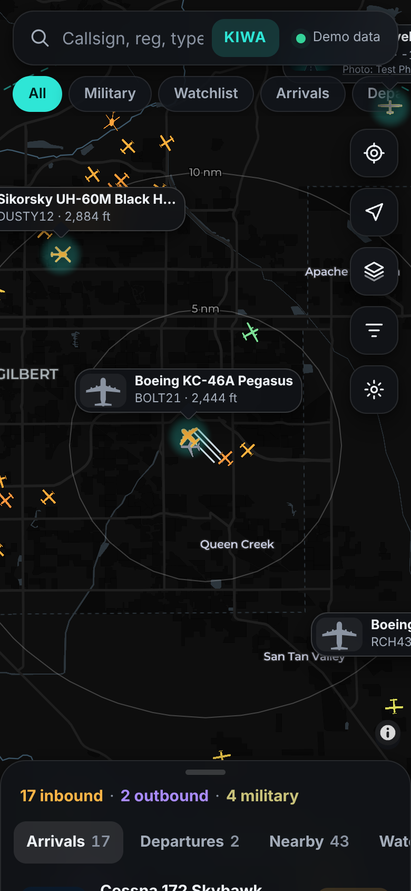
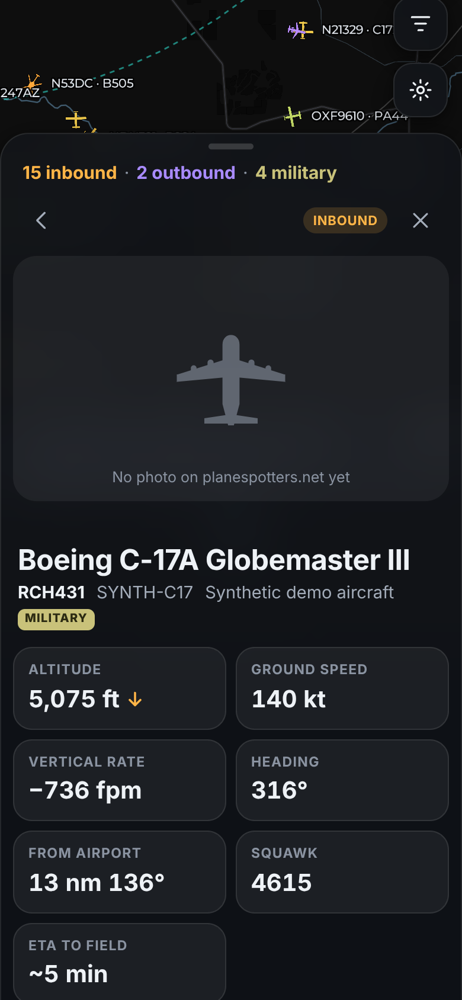
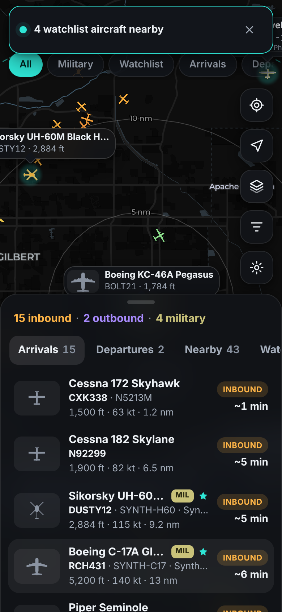
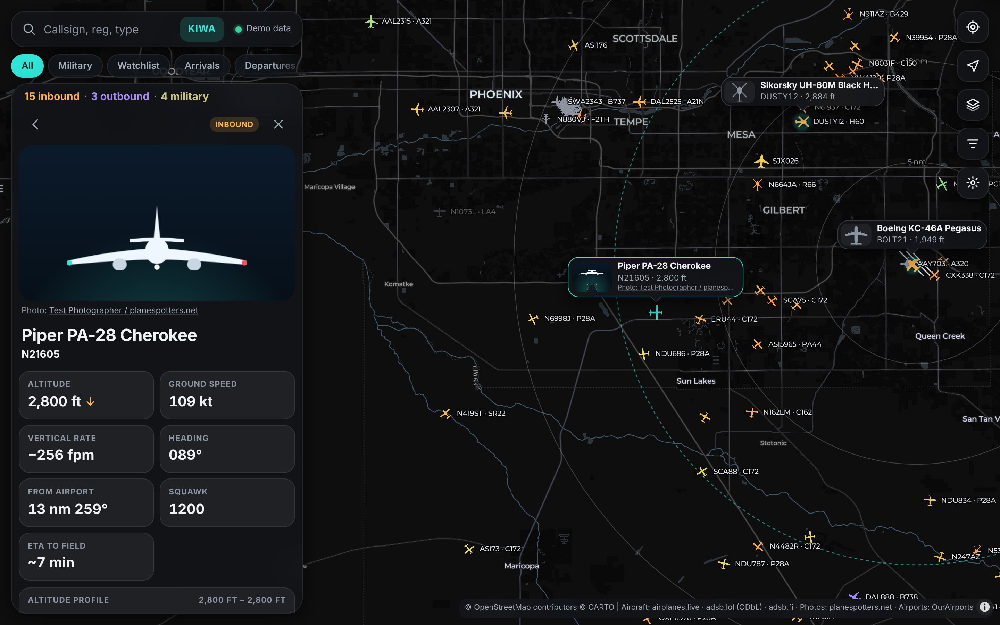

# Final Approach

**Live arrivals, departures, military and other interesting aircraft near any airport — a plane spotting web app for your phone.**

Final Approach is a Progressive Web App for aviation photographers. Pick an airport (default: Phoenix‑Mesa Gateway, KIWA), keep the app open, and see what's inbound with an ETA, what just departed, and which military or watchlisted aircraft are about — with a real photo of the actual airframe floating next to it on the map.

It runs entirely in your browser: no backend, no accounts, no analytics, no push notifications. Settings stay on your device.

**Live app:** `https://<your-user>.github.io/<repo>/` *(placeholder — see [Deploy to GitHub Pages](#deploy-to-github-pages))*
**Demo with recorded traffic:** add `?demo=1` to the URL.

| Map with photo bubbles | Aircraft details | Spotting board |
|---|---|---|
|  |  |  |



> Screenshots are from demo mode. In tests the planespotters.net API is mocked, so the "photo" in screenshots is the app icon credited to a fictional "Test Photographer"; the live app shows real photos with real credits.

## Features

- **Live map** (MapLibre GL) with range rings at 5/10/20 nm, your chosen radius, and runways drawn from OurAirports.
- **Original aircraft silhouettes** (narrowbody, widebody, regional, bizjet, turboprop, piston, helicopter, fighter, military heavy, glider/other), coloured by altitude: gray on the ground, warm when low, cool when high. Military aircraft get a khaki outline; watchlist matches pulse.
- **Smooth motion**: aircraft are dead‑reckoned between updates and eased to each new position — no jumping.
- **Trails** (default 10 minutes) for the selected aircraft, coloured by altitude; optional faint trails for everyone.
- **Photo bubbles**: the selected aircraft carries a floating card with a real photo, type, callsign and altitude. Optional small bubbles for up to 6 nearby watchlist matches.
- **Spotting board**: Arrivals (sorted by ETA), Departures, Nearby and Watchlist tabs. Counts like "3 inbound · 2 outbound · 1 military".
- **Inbound/outbound logic**: distance, bearing, AGL and closing angle → INBOUND, OUTBOUND, ON GROUND, PATTERN, OVERFLIGHT or AREA, with ETA. Optionally enriched with adsb.lol's *plausible routes*.
- **Details sheet**: hero photo with credit, stat tiles (altitude with climb/descent arrow, speed, vertical rate, heading, distance from field and from you, squawk, ETA), altitude sparkline, Follow, add type to watchlist, copy registration, open on globe.airplanes.live or planespotters. Emergency squawks (7500/7600/7700) show a red banner.
- **Search & filters**: callsign, registration, hex, type code or description; chips for All, Military, Watchlist, Arrivals, Departures, Helicopters, Hide ground; radius (5–50 nm) and altitude ceiling sliders.
- **Watchlist** with one‑tap presets (Military Heavies, Fighters, Rotary, Widebodies), registrations and callsign prefixes; "treat all military as matches"; optional chime + toast when a new match enters your radius (only while the app is open).
- **Settings**: airport picker (ICAO/IATA/name/city search over ~5,000 airports, or a custom location), units, poll interval, provider choice, proxy URL, map style (dark/light/satellite), labels, trails, wake lock, theme, API key store, export/import/reset.
- **PWA**: installable, works offline for the app shell and demo, update prompt when a new version is deployed.

## Important: live data needs a small proxy

During development every data source was tested from a browser‑like origin (details in [PLAN.md](PLAN.md)):

| Source | Works? | Browser CORS |
|---|---|---|
| adsb.lol | ✅ | ❌ no `Access-Control-Allow-Origin` |
| adsb.fi | ✅ | ❌ no `Access-Control-Allow-Origin` |
| airplanes.live | ⚠️ returned HTTP 403 from a cloud IP ("contact us") | ❌ |
| planespotters.net photos | ⚠️ API sends `*`, but rejects clients it considers automated (see below) | ✅ `*` |
| CARTO / Esri map tiles | ✅ | ✅ `*` |

Because **none of the ADS‑B position APIs allow direct browser requests**, a web page on GitHub Pages can't read them on its own. The fix is a tiny, free, personal proxy (a Cloudflare Worker, ~80 lines, included in [`proxy/cloudflare-worker.js`](proxy/cloudflare-worker.js)) that only talks to the three ADS‑B hosts and adds CORS headers. You paste its URL into **Settings → Live data → Proxy URL**. Until then, the app shows a banner and you can use **Demo mode**.

The app still tries the providers directly first, so if any of them enables CORS in the future, it will just work.

### Deploy the proxy (Cloudflare Workers, free plan)

1. Create a free account at <https://dash.cloudflare.com/sign-up>.
2. In the dashboard: **Workers & Pages → Create → Create Worker**. Give it a name, e.g. `final-approach-proxy`, and click **Deploy**.
3. Click **Edit code**, replace everything with the contents of [`proxy/cloudflare-worker.js`](proxy/cloudflare-worker.js), and click **Deploy**.
4. *(Recommended)* **Settings → Variables and Secrets → Add**: name `ALLOWED_ORIGINS`, value `https://<your-user>.github.io` (comma‑separate several). This stops other sites from using your proxy.
5. Copy the worker URL (like `https://final-approach-proxy.<you>.workers.dev`).
6. In the app: **Settings → Live data → Proxy URL**, paste it, then tap **Test connection**.

Or with the CLI: `npx wrangler deploy proxy/cloudflare-worker.js --name final-approach-proxy --compatibility-date 2024-11-01`.

The worker forwards `GET` requests to `api.airplanes.live`, `api.adsb.lol` and `opendata.adsb.fi`, plus `POST` to `api.adsb.lol/api/0/routeset`; everything else is rejected. It stores and logs nothing. The free plan's 100,000 requests/day is far more than one phone polling every 5 seconds (~17,000 per day of continuous use). The app's own limiter still keeps requests to each provider at **≤ 1 per second**.

## Known limitations

- **Live data requires the proxy** (above). Without it the app runs in demo mode only.
- **airplanes.live** answered HTTP 403 ("please contact us") to requests from a cloud server during testing. From a Cloudflare Worker it may behave the same; the app then falls back to adsb.lol automatically (verified) and retries airplanes.live with backoff. If you want it as a primary source, contact them.
- **planespotters.net** blocks clients without a "real" browser identity: plain scripts get a 403 asking for a User‑Agent with contact details, and in testing headless Chromium also got a 403 (without CORS headers). Normal Safari/Chrome should be fine, but this couldn't be confirmed from the test environment. When a lookup fails the app shows a clean silhouette with "Photo service unavailable right now" and retries that aircraft after 15 minutes.
- **adsb.lol plausible routes** returned empty responses during development, so the route label rarely appears; it's used only through the proxy.
- **Type descriptions**: adsb.lol doesn't return `desc`/`ownOp`/`year`; a built‑in table of common ICAO types fills in the description. adsb.fi returns all three.
- **KC‑46A** is reported by ADS‑B databases as `B762` with the military flag; the `K46` watchlist entry matches those too.
- Arrivals are inferred from geometry (descending, pointing at the field). Near busy neighbouring airports (e.g. PHX, CHD, FFZ around KIWA) some aircraft listed as inbound are actually going next door.

## Quality checks

- 57 unit tests (`npm test`) and 11 Playwright e2e tests (`npm run test:e2e`) at 390×844 and 1440×900: no console errors, aircraft render, selection opens details with photo + credit, photo bubble follows the icon, altitude-coloured trail, sheet detents, settings persistence and export/import, presets, military filter, pause when hidden, service worker + offline reload from `/final-approach/`, provider fallback, and ≤ 1 request/second per host (timed inside the page).
- Lighthouse 12 (mobile, demo mode): Accessibility 100, Best Practices 100. Chrome reports no installability errors.
- Live check (`scripts/live-check.mjs`) through the worker code: first aircraft after ~2 s; aircraft count matched a direct adsb.lol query for the same area (70 vs 69).

## Install on iPhone

1. Open the app's URL in **Safari**.
2. Tap the **Share** button.
3. Choose **Add to Home Screen**, then **Add**.
4. Launch it from the home screen — it opens full screen like a native app.

(On Android/Chrome: menu → **Install app**.)

## Deploy to GitHub Pages

1. Push this repository to GitHub (it's a static site — no build step).
2. **Settings → Pages → Build and deployment → Source: Deploy from a branch**, branch `main`, folder `/ (root)`, **Save**.
3. After a minute the app is live at `https://<your-user>.github.io/<repo>/`. All paths are relative, so it works from the project subpath.
4. Update the *Live app* link at the top of this README.

When you push changes, bump `VERSION` in `sw.js` so installed copies see the "Update available — tap to reload" toast.

## Run locally

Requires Node 20+ (only for the dev server and tests — the app itself has no dependencies).

```bash
npm start                      # http://localhost:8080/final-approach/  (served from a subpath, like GitHub Pages)
open http://localhost:8080/final-approach/?demo=1
```

Useful scripts:

```bash
npm test                       # unit tests (node:test): spotting, geo, units, settings migration, limiter, proxy…
npm run test:e2e               # Playwright e2e at 390×844 and 1440×900 (needs Playwright + Chromium installed)
SCREENSHOTS=1 npm run test:e2e # …and refresh docs/screenshots
npm run build:airports         # regenerate data/airports.json + data/runways.json from OurAirports
npm run capture                # record a fresh fixture near KIWA (adsb.lol) and rebuild the demo fixture
npm run icons                  # re-render PNG icons from icons/icon.svg
NODE_USE_ENV_PROXY=1 node scripts/live-check.mjs --shot live.png   # real-data check through the worker code
```

## Privacy

- No accounts, cookies, analytics or third‑party scripts. MapLibre is vendored in `vendor/`.
- Settings, watchlist and API keys are stored in your browser's localStorage; photo and route lookups are cached in IndexedDB. Nothing is uploaded.
- Network requests go only to: the ADS‑B providers (or your own proxy), planespotters.net (photo lookups and images), CARTO / Esri (map tiles) and this site. Requests are sent with `referrerPolicy: no-referrer` and without credentials.
- Your location is requested only when you tap the location button and never leaves the device.

## Data sources, attribution and terms

This project is for **personal, non‑commercial use**. Respect each provider's terms:

- **[airplanes.live](https://airplanes.live)** — free API for non‑commercial use, attribution required, max 1 request/second. Their API currently asks automated/hosted clients to contact them (`contact@airplanes.live`).
- **[adsb.lol](https://adsb.lol)** — data licensed under the **[Open Database License (ODbL 1.0)](https://opendatacommons.org/licenses/odbl/)**; © adsb.lol contributors. The recorded demo fixture in `fixtures/` is adsb.lol data and is redistributed under ODbL with this attribution. Routes come from adsb.lol's `routeset` endpoint and are labelled "plausible route". (During development that endpoint returned empty responses; the app degrades gracefully.)
- **[adsb.fi](https://adsb.fi)** — open data API, 1 request/second, attribution and a link back required, non‑commercial.
- **[planespotters.net](https://www.planespotters.net/photo/api)** — photos are © their photographers. The app shows "Photo: {photographer} / planespotters.net" linking to the photo page wherever a photo appears, and loads images directly from planespotters' servers (never re‑hosted). Lookups are rate limited and cached for 7 days.
- **[OurAirports](https://ourairports.com/data/)** — airport and runway data, public domain.
- **Map tiles** — © [OpenStreetMap](https://www.openstreetmap.org/copyright) contributors, © [CARTO](https://carto.com/attributions) (Dark Matter / Positron basemaps; free for limited non‑commercial use under CARTO's terms). Satellite imagery © [Esri](https://www.esri.com/), Maxar, Earthstar Geographics and the GIS User Community (Esri World Imagery; subject to Esri's terms of use).
- **[MapLibre GL JS](https://maplibre.org)** 6.15.0 — BSD‑3‑Clause, see `vendor/LICENSE-maplibre.txt`.

ADS‑B data is crowd‑sourced and may be delayed, incomplete or wrong. **Not for navigation or any safety‑related use.**

## Project layout

See [PLAN.md](PLAN.md) for the verification log, design decisions and file structure.

## License

[MIT](LICENSE) © Final Approach contributors. Third‑party data and libraries keep their own licenses (above).
